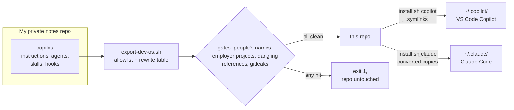
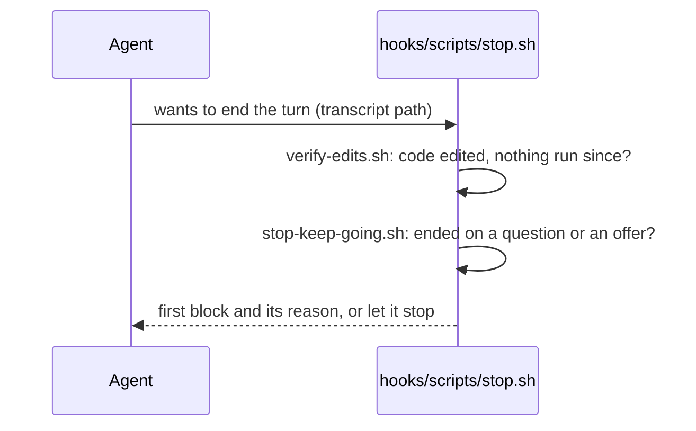

# copilot-dev-os

[](https://github.com/Mingz6/copilot-dev-os/actions/workflows/ci.yml)
[](LICENSE)

The rules, agents, skills and hooks I run GitHub Copilot and Claude Code with, so an agent finishes the job, checks its own work and only stops for what a person has to decide.


*`./docs/demo.sh` installs into a throwaway home folder and feeds the Stop hook three made-up agent transcripts. No editor, accounts or keys.*

## Why it exists

I hand an agent a task and walk away for half an hour. Out of the box, both Copilot and Claude Code stop early: they ask "want me to run the tests?", skip the last steps of a long checklist, or say "that should work" without running anything. Every file here is a fix I kept after a session went wrong in one of those ways.

The live copy sits in my private notes repo next to things that are nobody else's business. This repo is exported from it by a script: an allowlist of files, a short rewrite table, and gates that refuse to export if a name, an employer project or a secret gets through. So what you fork is what I run, minus the personal parts.

## Quickstart

You need git, bash and jq; the Claude Code target also needs python3. From a fresh clone:

```bash
git clone https://github.com/Mingz6/copilot-dev-os.git ~/copilot-dev-os
cd ~/copilot-dev-os
bash tests/run.sh    # 37 checks: the hooks, the installer, every file's frontmatter
./docs/demo.sh       # the Stop hook on three made-up transcripts
```

**VS Code with GitHub Copilot.** Link the files into your user folder (nothing of yours gets overwritten; a clash is reported and skipped):

```bash
./install.sh copilot   # symlinks into ~/.copilot/instructions, agents, skills and hooks
```

VS Code reads `~/.copilot/instructions`, `~/.copilot/agents` and `~/.copilot/skills` by default. Hooks for the Local agent harness are a preview feature and only load from folders you list, so add this to your user `settings.json`:

```jsonc
"chat.hookFilesLocations": { "~/.copilot/hooks": true }
```

Open Chat in Agent mode. `/long-run`, `/grill-me`, `/tdd` and `/diagnose` show up as skills, and the agents in the agent picker. A `git pull` updates everything, since they're links.

**Claude Code.** Claude reads `paths` where Copilot reads `applyTo`, and its own model names, so agents and rules are written as converted copies:

```bash
./install.sh claude    # skills linked; agents and rules converted into ~/.claude/; hooks added to ~/.claude/settings.json
```

Re-run it after every `git pull`. Your existing `settings.json` is kept (a backup goes next to it) and the hooks are added once, however often you run it.

Either target takes `--dry-run`, and `./install.sh uninstall` removes every link, generated file and hook entry it added. If you install both, VS Code also reads `~/.claude/skills` and `~/.claude/rules` by default and lists those twice; turn them off in `chat.agentSkillsLocations` and `chat.instructionsFilesLocations`.

## What's inside

| Folder | What | Highlights |
|---|---|---|
| [`instructions/`](instructions/) | 17 rule files. Two load on every request, the rest by file type through `applyTo` | [`agent-execution-loop`](instructions/agent-execution-loop.instructions.md): nine hard laws, when to stop, the verify loop, the report format. [`anti-ai-voice`](instructions/anti-ai-voice.instructions.md): banned phrases and a density test, so messages read like a person wrote them. Plus C#, Python, TypeScript, React, SQL, API design, error handling, observability and spec-driven development |
| [`agents/`](agents/) | 9 custom agents | **Zero-Interrupt Orchestrator** (takes a brief, writes a spec, builds it test-first, loops until six checks pass), **Code Perfectionist**, **SE: Security**, **Polyglot Build Runner**, and specialists for .NET, React, GitHub Actions, Azure and SQL Server |
| [`skills/`](skills/) | 5 skills | `/long-run` (the orchestrator's loop), `/grill-me` (questions climb a ladder: the agent, then you, then the colleague who knows), `/tdd`, `/diagnose`, `/nuget-manager` |
| [`hooks/`](hooks/) | 2 hook configs, 6 scripts | `post-edit-lint` (syntax check after every edit), `stop` (sends the agent back when it edited code and ran nothing, or ended on a question it could answer), `long-run-continue` (keeps the orchestrator going while its spec says in-progress), `claude-adapter` (runs the same scripts under Claude Code) |
| [`claude/`](claude/) | 1 rule | how the Copilot tool names in the rules map to Claude Code's |

## How it fits together



At runtime the Stop hook is a small dispatcher. Each check is its own script with its own loop guard, so a check can block a few times and never forever:



## Stack

Markdown files with frontmatter in the formats VS Code reads (custom instructions, custom agents, agent skills). Hooks in Bash and jq. The installer is Bash with a small Python converter for Claude Code. CI (continuous integration) runs on GitHub Actions: markdownlint, lychee for links, shellcheck and the test suite.

## Status

Exported on 2026-11-10 from the setup I use every day in VS Code Copilot and Claude Code on macOS. CI runs the hooks and the installer on Ubuntu on every push and pull request. The rules are tuned to my stacks (C#, React, SQL Server, Python); keep the ones that match yours and delete the rest.

## Decisions and trade-offs

- **Export from one source, don't keep a second copy.** A hand-made public copy went six months stale. The script reads my live files, so a refresh is one command. The cost is the rewrite table: when a source file changes, a rule that no longer matches fails the export on purpose, rather than shipping whatever the change let through.
- **The gates read their lists at runtime.** Names of people and employer projects come from folder names on my machine, never from the script, so the script itself leaks nothing. If those folders are missing the export refuses to run.
- **Hooks for the two rules agents skip most.** "Run something after you edit code" and "don't end on a question" are in the instructions too, but only a Stop hook holds the line. Each one blocks a bounded number of times, then lets the turn end.
- **Copilot's format is the source, Claude Code is converted.** The hook scripts read VS Code's transcript and tool names; `claude-adapter.sh` rewrites Claude's into that shape. The cost: a new Claude tool name needs a line in the adapter.
- **Fewer files.** The May copy had 48 instructions, agents and skills; 8 of those skills no longer existed in my setup and several pointed at tools only I have. This one ships 31 plus the hooks, each of which works without anything else from my machine.
- **Lenient lint, strict links.** markdownlint skips line length and spacing rules, since the files are prose for agents with one paragraph per line. Relative links and anchors must resolve; external links are retried and reported without failing the build.

## Make it yours

1. Fork it, then delete the instruction files for stacks you don't use and edit the rest.
2. Keep `agent-execution-loop` and `anti-ai-voice`, or swap in your own always-on rules (`applyTo: '**'`).
3. Run `bash tests/run.sh` after changing a hook. It feeds each script made-up transcripts and checks its answer.

## License

[MIT](LICENSE)
